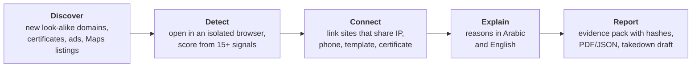
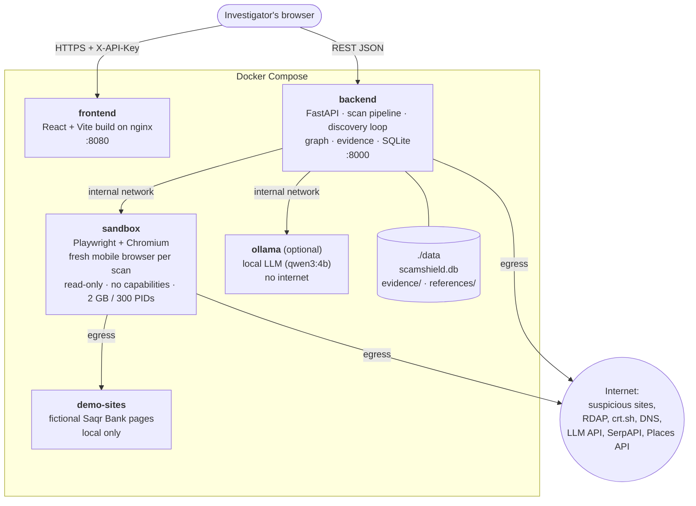
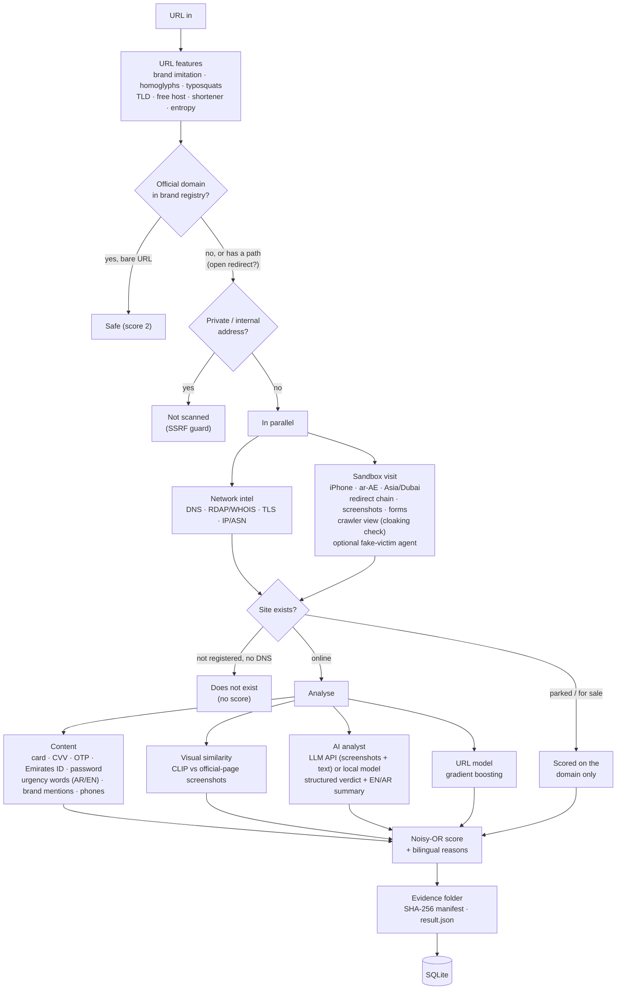
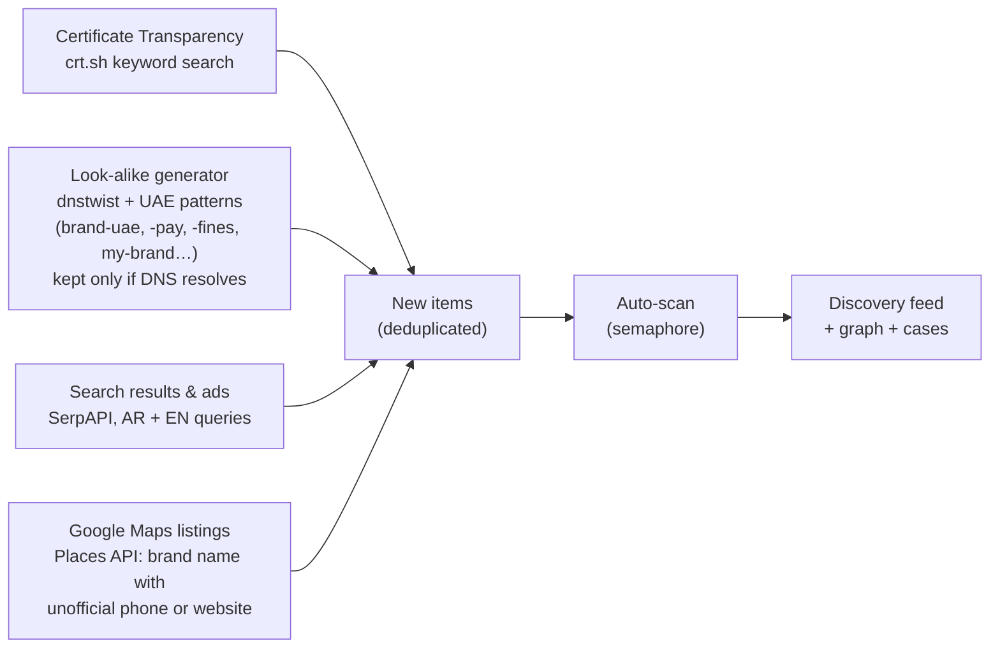
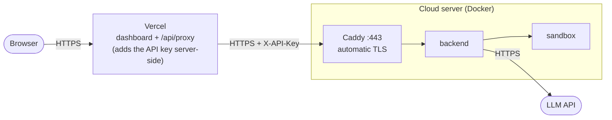

# ScamShield AI

**Find scam websites before victims do. Check them safely. Explain the risk in Arabic and English. Hand police the evidence.**

Built for the **Abu Dhabi Police × 42 Abu Dhabi** hackathon. ScamShield is an investigator dashboard and API that discovers fraudulent websites and fake Google Maps listings targeting UAE residents, opens them only inside an isolated browser, scores them with explainable signals, links sites run by the same operator, and packages police-ready evidence for takedown.

---

## Contents

1. [The idea](#1-the-idea)
2. [What the investigator sees](#2-what-the-investigator-sees)
3. [Architecture](#3-architecture)
4. [How detection works](#4-how-detection-works)
5. [Technologies](#5-technologies)
6. [Evidence and takedown](#6-evidence-and-takedown)
7. [UAE relevance](#7-uae-relevance)
8. [Results](#8-results)
9. [Getting started](#9-getting-started)
10. [API overview](#10-api-overview)
11. [Repository layout](#11-repository-layout)
12. [Roadmap](#12-roadmap)
13. [Pilot path with Abu Dhabi Police](#13-pilot-path-with-abu-dhabi-police)
14. [Team](#14-team)

---

## 1. The idea

### The problem

Scam links aimed at UAE residents (fake bank logins, fake traffic-fine payments, fake parcel fees, fake "customer care" numbers on Google Maps) spread through SMS, search ads and Maps listings far faster than victims report them. Today an investigator has to:

- open a suspicious link to see what it is, which is risky;
- find new scam sites one report at a time, after people have already lost money;
- work out by hand which sites belong to the same criminal operation;
- assemble screenshots, WHOIS records and hosting details into something a registrar or host will act on.

### What ScamShield does

Five steps, each automated:



| Step | What it does |
|---|---|
| **Discover** | Watches Certificate Transparency logs, generates and DNS-checks look-alike domains of UAE brands, monitors search results/ads and Google Maps listings. Every new find is scanned automatically. |
| **Detect** | Opens each link in a sandboxed mobile browser, never on the investigator's machine, and scores it from URL, registration, hosting, TLS, redirects, page content, visual similarity, a URL model and a local AI analyst. |
| **Connect** | Builds a fraud network graph: domains linked by a shared IP, phone number, form template, page appearance, TLS certificate or name server. |
| **Explain** | Every score comes with plain-language reasons in both languages. Addresses that don't exist get no score; internal addresses are never opened. |
| **Report** | Saves every artefact with a SHA-256 manifest (chain of custody), exports PDF and JSON, and drafts the takedown email to the registrar's abuse contact. |

### Who it is for

Police cyber-crime investigators and takedown teams first; later the same `/api/scan` endpoint can serve a citizen-facing WhatsApp/Telegram bot.

---

## 2. What the investigator sees

A bilingual dashboard (full right-to-left Arabic) with four screens:

| Screen | Purpose |
|---|---|
| **Scan** | Paste a link or upload a CSV. Watch the sandbox steps, then get a 0–100 risk score, the reasons, screenshots of the suspicious page next to the real brand page, registration/hosting facts, and buttons to download the evidence pack or add the scan to a case. |
| **Discovery** | Live feed of newly found suspicious domains and Maps listings, with source, impersonated brand, risk and time since detection. |
| **Network** | Force-directed graph of scam clusters. Select a cluster to see its shared indicators and domains, then generate a cluster report in one click. |
| **Reports** | Investigation cases with an AI summary in English and Arabic, the evidence list, the redirect chain, and PDF / JSON export. |

A **Demo** button in the header plays a ~35-second guided walkthrough of all four screens. If the API is unreachable, the dashboard shows a banner and falls back to saved demo data, so a live presentation never shows a blank screen.

---

## 3. Architecture

### 3.1 Services and networks

Five containers, two networks. The sandbox is the only component that ever touches a suspicious website; the local AI model has no internet access at all.



| Network | Members | Internet? |
|---|---|---|
| `internal` | backend, sandbox, ollama | **No** (`internal: true`) |
| `egress` | backend, sandbox, demo-sites | Yes |

Only the backend (`:8000`) and frontend (`:8080`) publish ports. The sandbox, Ollama and demo sites are reachable only inside Docker.

### 3.2 The scan pipeline

What happens when a URL is submitted (`POST /api/scan`, the UI, the batch CLI, or the discovery loop):



### 3.3 The discovery loop

Starts a cycle every `DISCOVERY_INTERVAL_MIN` minutes (and on demand via `POST /api/discovery/run`). New items are de-duplicated by `(source, item)`. Each cycle auto-scans newest-first within `SCAN_BUDGET_SEC`; whatever is left waits in the backlog and later cycles drain it, so one large look-alike sweep cannot hold a cycle open. Pollers are capped at `POLL_BUDGET_SEC` and the dnstwist sweep (~23s and ~4k permutations per official domain) rotates `DNSTWIST_PER_CYCLE` domains per cycle, so a cycle always fits inside the interval.



### 3.4 The fraud network graph

Built with `networkx` from every scan scoring 40 or more. Each domain links to its indicator nodes; connected components with two or more domains become **clusters**. To keep clusters meaningful, shared CDN/cloud IPs (Cloudflare, AWS, Google, Azure…), mass DNS providers and indicators shared by more than 25 domains are ignored, and page-appearance links count only for pages that collect data.

| Indicator | Example |
|---|---|
| Shared IP | `47.79.39.190` |
| Phone number | `+971 50 000 0000` |
| Form template | hash of the form's field signature |
| Page appearance | perceptual hash of the screenshot |
| TLS certificate | certificate serial |
| Name server | `ns7.alidns.com` |

---

## 4. How detection works

### 4.1 Explainable noisy-OR score

Each signal that fires has a weight *w* between 0 and 1. The score is

> **score = 100 × (1 − ∏ (1 − wᵢ))**

so independent pieces of evidence add up, no single weak signal can push a site to "scam", and every point of the score traces back to a named reason. **Scam ≥ 70 · Suspicious ≥ 40 · Safe < 40.**

| Signal | Weight | Module |
|---|---|---|
| Visual clone of the official page (CLIP similarity ≥ 0.88) | 0.70 | `visual.py` |
| Domain imitates a brand: homoglyph / one-edit typosquat / keyword | 0.65 / 0.60 / 0.50 | `url_features.py` |
| AI analyst (LLM) says scam | 0.6 × confidence | `llm.py` |
| Page asks for card / CVV | 0.55 | `content.py` |
| Domain registered < 7 days / < 30 days ago | 0.50 / 0.30 | RDAP |
| Visual similarity ≥ 0.80 to the *same* brand the domain or page claims | 0.50 | `visual.py` |
| URL pattern model | 0.5 × probability | `ml_model.py` |
| Page asks for OTP / Emirates ID / password | 0.45 / 0.40 / 0.30 | `content.py` |
| Different site shown to crawlers than to phones (cloaking) | 0.45 | sandbox crawler view |
| Brand named on the page *and* the page asks for data (or the domain imitates it) | 0.35 | `content.py` |
| Punycode host / raw IP host | 0.35 | `url_features.py` |
| Cross-site redirects or short link | 0.20 | sandbox redirect chain |
| TLS certificate issued in the last 3 days | 0.20 | TLS |
| High-abuse TLD · free site builder · pressure language | 0.15 each | `brands.yaml` |

### 4.2 Results that are not a risk score

Not every address deserves a number. These outcomes are reported explicitly instead:

| Outcome | When | What the UI shows |
|---|---|---|
| **Safe (official)** | Domain is in the UAE brand registry and nothing redirects elsewhere | Safe, "Official domain" |
| **Does not exist** | Not registered and no DNS records | "This website does not exist" (and a note if the name imitates a brand) |
| **Parked / for sale** | Look-alike lands on a domain marketplace | Scored on the domain alone, "worth monitoring" |
| **Offline** | Registered, but nothing loads (taken down or not live yet) | Score based on the domain only, labelled as such |
| **Not scanned** | Points to a private or internal address | Never opened or probed |

### 4.3 Design choices that cut false positives

Found by testing against real legitimate UAE sites, and fixed with general rules rather than per-site exceptions:

- Redirects and cloaking compare **registered domains**, so `http → https → www → /ar` on one site is normal.
- Mentioning a brand counts only alongside a data-collecting form or brand imitation (news sites mention Salik and Etisalat all the time).
- English pressure words match whole words only ("fine" is not "define").
- Common-word brands (Apple, Amazon, DHL, Amex) must appear as a whole label, so `pineapple.com` is fine.
- Moderate visual similarity counts only when it points at the brand the site claims to be.

---

## 5. Technologies

| Layer | Technology | Why |
|---|---|---|
| **Front end** | React 18 · TypeScript · Vite · plain CSS with design tokens | Fast, typed, small (≈66 kB gzipped). Full RTL Arabic. Works offline on saved demo data. |
| **API** | FastAPI (Python 3.11) · Pydantic · Uvicorn | Async I/O for many parallel network lookups; typed request models; automatic docs at `/docs`. |
| **Isolated browser** | Playwright + Chromium in its own container | Real browser rendering (JavaScript redirects, client-side forms) with an iPhone profile, `ar-AE` locale and Dubai time zone, so pages behave as they do for victims. |
| **Network intelligence** | dnspython · RDAP (rdap.org) · Python `ssl` + `cryptography` · ipwho.is | Domain age, registrar and abuse contact, certificate age and issuer, hosting country and ASN, all without paid feeds. |
| **Brand imitation** | tldextract (Public Suffix List) · RapidFuzz (Levenshtein) · Unicode confusable mapping | Correct registered domains (incl. `*.vercel.app` subdomains), typosquats, homoglyphs like `rnicrosoft` / `paypa1`. |
| **Visual similarity** | CLIP `ViT-B-32` via sentence-transformers · PyTorch (CPU) · imagehash | Compares the suspicious page with official-page screenshots; perceptual hashes link look-alike pages in the graph. |
| **AI analyst** | Multimodal **LLM API** *or* a **local model** (Ollama, `qwen3:4b`) | Reads the screenshots and page text (Arabic or English) and returns a schema-validated verdict with a bilingual summary. The local option runs fully on-premise with no internet. Switch with `LLM_PROVIDER`. |
| **URL model** | scikit-learn `HistGradientBoostingClassifier` | Trained on our own URL features over the public `pirocheto/phishing-url` dataset (≈11k URLs). |
| **Discovery** | crt.sh (Certificate Transparency) · dnstwist · SerpAPI · Google Places API (New) | Early detection from four independent sources: new certificates, registered look-alikes, search ads, Maps listings. |
| **Graph** | networkx | Connected components over shared indicators. |
| **Evidence** | Jinja2 HTML template → PDF rendered by the sandbox's Chromium | Correct Arabic text shaping in PDFs with no extra system libraries. |
| **Storage** | SQLite + evidence folders on disk | Zero-ops for a pilot; every file hashed with SHA-256. |
| **Deployment** | Docker Compose (5 services, 2 networks) | One command; runs on a single on-premise server or a laptop. |

---

## 6. Evidence and takedown

Every scan writes `data/evidence/<scan_id>/`:

| File | Content |
|---|---|
| `screenshot_N.png` | Every page the sandbox saw (landing page, then each step of the agent walk-through) |
| `page.html` | Rendered HTML |
| `network.json` | Every request the page made |
| `intel.json` | DNS, RDAP/WHOIS, TLS, hosting |
| `result.json` | The full verdict with reasons |

A **SHA-256 manifest** of all files is stored with the result (chain of custody). From there:

- **PDF report** per scan or per case: verdict and reasons (EN + AR), screenshots in order, redirect chain, registration, hosting, TLS and the hash table.
- **JSON export** for takedown pipelines.
- **Takedown draft** (`/api/scans/{id}/takedown.txt`) addressed to the registrar's abuse contact and the hosting provider, with reasons, timestamps and hashes.

---

## 7. UAE relevance

- **Brand registry** (`backend/app/brands.yaml`): UAE banks (ADCB, FAB, ENBD, ADIB, DIB, Mashreq, RAKBANK…), government (TAMM, UAE PASS, Abu Dhabi Police, Dubai Police, RTA, DEWA, MOI), Salik, Emirates Post, e&, du, Emirates, Etihad, ADNOC, Aramex, plus global brands commonly phished in the UAE. All `*.gov.ae` domains are trusted.
- **Arabic everywhere**: full RTL interface, bilingual reasons and summaries, Arabic urgency keywords (مخالفة، غرامة، سيتم إيقاف، تحديث بياناتك…), Arabic form-field labels (بطاقة، رمز التحقق، الهوية).
- **Victim's-eye view**: the sandbox browses as an iPhone with `ar-AE` locale on Dubai time.
- **UAE look-alike patterns**: `{brand}-uae`, `{brand}-fines`, `{brand}ae`, `my{brand}` and more.
- **On-premise AI**: no case data is sent to an external AI service.

---

## 8. Results

Labelled set `data/eval/labeled.csv`: **147 URLs**. 65 live phishing URLs sampled from the OpenPhish community feed on 24 Nov 2026 (one per domain), and 82 legitimate sites (every official UAE brand domain plus popular UAE and global sites). Most phishing in that feed targets global brands rather than UAE ones, which makes it a hard test for a UAE-focused detector.

| Mode | Threshold | Precision | Recall | F1 | False-positive rate | FPR on official UAE domains |
|---|---|---|---|---|---|---|
| Full pipeline (sandbox) | score ≥ 40 (default `is_scam`) | **1.00** | **0.77** | **0.87** | **0.00** | **0.00** |
| Full pipeline (sandbox) | score ≥ 70 ("scam" verdict) | 1.00 | 0.25 | 0.40 | 0.00 | 0.00 |
| Fast (URL + network intel, no sandbox) | score ≥ 40 | 1.00 | 0.74 | 0.85 | 0.00 | 0.00 |

- Full-pipeline numbers were measured without the visual and LLM signals. Reproduce with `python -m app.eval data/eval/labeled.csv [--fast]`.
- URL model alone (held-out test split of `pirocheto/phishing-url`, 3,772 URLs): accuracy 0.841, phishing F1 0.836.
- An earlier version had 5 false positives on legitimate UAE retail and news sites (Lulu, Sharaf DG, UAEU…). They were fixed with the general rules in [4.3](#43-design-choices-that-cut-false-positives), not by allowlisting those sites.
- **With the LLM analyst on** (25 Nov 2026, same set, re-run in Docker): precision 1.00, recall 0.74, F1 0.85 at score ≥ 40, **no false positives**. On the demo look-alikes the analyst identified the brand and the password → card → CVV → OTP flow from the screenshots in about 10 s per scan.
- Speed in Docker on a laptop: about 7–15 s per full scan (sandbox, agent, CLIP, local LLM) once warm.

The set is small and live phishing pages die within hours, so treat these numbers as indicative.

---

## 9. Getting started

### Docker (recommended)

```bash
cp .env.example .env                                   # set API_KEY; optional SERPAPI_KEY / GOOGLE_PLACES_KEY
docker compose up -d --build                           # set the LLM API key in .env
# or, fully on-premise: LLM_PROVIDER=ollama, then
#   docker compose --profile llm up -d --build && docker compose run --rm ollama-pull
docker compose exec backend python -m app.capture_refs # official-page screenshots for visual similarity
docker compose exec backend python -m app.seed_demo    # demo data from real scans
open http://localhost:8080
```

- The backend warms up CLIP and the model in the background at startup (about 2 minutes on CPU). Wait for that before the first demo scan.
- macOS with Colima: give the VM at least 8 CPUs / 12 GB (`colima start --cpu 8 --memory 14`). If image builds fail with DNS timeouts, Colima's DNS forwarder is stuck: point the VM at your router's DNS (`colima ssh -- sudo sh -c 'echo nameserver <router-ip> > /etc/resolv.conf'`).

### Deploy: backend on a cloud server, dashboard on Vercel

The backend needs Docker, a sandboxed Chrome, a background discovery loop and a disk, so it runs on a small server (e.g. Hetzner Cloud, 4 vCPU / 8 GB, Ubuntu 24.04). The dashboard is a static site on Vercel.



1. **Server:** create it with your SSH key, then from this repo run
   ```bash
   deploy/deploy.sh <server-ip> [domain]     # domain defaults to <server-ip>.sslip.io
   ```
   First run: installs Docker, firewall (SSH, 80, 443 only), key-only SSH, automatic security updates and swap; then copies the code, data and a `chmod 600` `.env` built from your local `.env`, starts backend, sandbox, demo sites and Caddy, and waits for `https://<domain>/health`. Re-run it to deploy updates.
2. **Vercel:** import the repo with **Root Directory `frontend`** (settings come from `frontend/vercel.json`), and set
   - `VITE_API_URL=proxy`: the dashboard calls `/api/proxy`, so **no key ships in the browser bundle**;
   - `BACKEND_URL=https://<domain>` and `API_KEY=<same as the server>`: used only by the proxy function.

   The proxy forwards only `/health` and `/api/*`, only `GET/HEAD/POST/PATCH`, drops cookies and client-supplied keys, and streams responses (no 4.5 MB cap on PDFs). Anyone who can open the Vercel URL can use the dashboard, so turn on Vercel's Deployment Protection for anything beyond a demo.

### Quick demo: Vercel only (no server)

For judges and quick trials the dashboard can run entirely on Vercel. `frontend/api/scan.js` is a serverless version of the scanner with the same detection rules (brand imitation, typosquats, domain age, safe HTML fetch with no JavaScript, forms and pressure words, LLM analyst, noisy-OR score). Discovery, Network and Reports show saved demo data. The full system with the isolated browser sandbox runs on the server above.

1. Import the repo on Vercel with **Root Directory `frontend`**.
2. Environment variables: `VITE_API_URL=lite` and the LLM API key listed in `.env.example`.
3. Deploy. Try the sample links under the scan box.

### Local development (no Docker)

```bash
python3.12 -m venv .venv && .venv/bin/pip install -r backend/requirements.txt playwright==1.47.0
.venv/bin/python -m playwright install chromium
.venv/bin/python demo-sites/dev_server.py &                                            # fictional demo sites on :8090
(cd sandbox && SANDBOX_HOST_RULES="MAP *.test 127.0.0.1:8090" ../.venv/bin/uvicorn server:app --port 9000) &
(cd backend && DATA_DIR=../data AGENT_ENABLED=true ../.venv/bin/uvicorn app.main:app --port 8000) &
(cd frontend && npm install && npm run dev)                                             # http://localhost:5173
```

### Batch scoring (hidden test set)

```bash
cd backend
python -m app.cli score input.csv predictions.csv          # full pipeline
python -m app.cli score input.csv predictions.csv --fast   # URL + network intel only
python -m app.eval ../data/eval/labeled.csv                # our own metrics
python -m app.train_url_model                              # retrain the URL model
```

Input needs a `url` column. Output: `url, verdict, score, is_scam, top_reasons`. `is_scam` uses `--threshold` (default 40). For domains that don't exist, `score` is the URL-only score, because a dead link in a phishing list is usually phishing that was already taken down. The same batch runs from the UI ("Upload CSV") or `POST /api/scan/batch`.

### Configuration (`.env`)

| Variable | Default | Purpose |
|---|---|---|
| `API_KEY` | `change-me` | Required by every `/api` call (`X-API-Key` header or `?key=`) |
| `LLM_PROVIDER` | see `.env.example` | AI analyst: cloud LLM API, `ollama` (on-premise) or `off` |
| `OLLAMA_MODEL` | `qwen3:4b` | Local analyst |
| `VISUAL_ENABLED` | `true` | CLIP visual similarity |
| `AGENT_ENABLED` / `AGENT_ALLOWED_SUFFIXES` | `false` / `.test` | Fake-victim agent, only on allowed hosts |
| `DISCOVERY_ENABLED` / `DISCOVERY_INTERVAL_MIN` | `true` / `5` | Background discovery loop |
| `SCAN_BUDGET_SEC` | `120` | Auto-scan time per cycle; the rest waits in the backlog |
| `POLL_BUDGET_SEC` | `120` | Poller time per cycle; stragglers are dropped and retried next cycle |
| `DNSTWIST_PER_CYCLE` | `3` | Official domains dnstwist sweeps per cycle, rotating |
| `SERPAPI_KEY` / `GOOGLE_PLACES_KEY` | empty | Enable search-ad and Maps discovery |
| `SCAN_CONCURRENCY` | `3` | Parallel scans in batch and discovery |
| `DEMO_MODE` | `false` | Serve the latest saved result for a domain instantly |

---

## 10. API overview

All routes are JSON under `/api` and need `X-API-Key` (or `?key=` for images and downloads). Interactive docs: `http://localhost:8000/docs`. Full contract: [`BUILD.md` section 10](BUILD.md).

| Method | Path | Purpose |
|---|---|---|
| GET | `/health` | Status of backend, sandbox, LLM, visual model, discovery |
| POST | `/api/scan` | Scan one URL: `{url, agent?, fast?}` |
| POST | `/api/scan/batch` · GET `/api/jobs/{id}` · `/api/jobs/{id}/csv` | Batch CSV scan and results |
| GET | `/api/scans` · `/api/scans/{id}` | Scan list / full result |
| GET | `/api/scans/{id}/screenshot/{n}` · `report.pdf` · `report.json` · `takedown.txt` | Evidence and exports |
| GET | `/api/discovery` · POST `/api/discovery/run` · GET `/api/stats` | Discovery feed, trigger, counters |
| GET | `/api/graph` | Nodes, edges and clusters |
| POST · GET · PATCH | `/api/cases` · `/api/cases/{id}` | Create, list, update cases |
| GET | `/api/cases/{id}/report.pdf` · `report.json` | Case evidence pack |

---

## 11. Repository layout

```
├── frontend/                 React dashboard (Scan · Discovery · Network · Reports)
│   └── src/                  api.ts (client) · views.ts (API → view models) · screens/ · components/GraphView.tsx
├── backend/
│   └── app/
│       ├── main.py           FastAPI routes, startup warm-up, discovery loop
│       ├── brands.yaml       UAE brand registry, allowlist, abuse-prone TLDs, hosts, keywords
│       ├── pipeline/         url_features · network_intel · sandbox_client · content · visual · llm · ml_model · scoring
│       ├── discovery/        ct_monitor · lookalikes · search · maps · loop
│       ├── graph.py          fraud network
│       ├── evidence.py       PDF / JSON / takedown draft (+ templates/report.html)
│       ├── cli.py · eval.py  batch scoring and evaluation
│       └── train_url_model.py · capture_refs.py · seed_demo.py
├── sandbox/server.py         isolated browser service (/visit, /pdf)
├── demo-sites/               fictional "Saqr Bank" test pages (local only)
├── data/
│   ├── eval/labeled.csv      evaluation set
│   └── references/           official-page screenshots for visual similarity
├── deploy/                   server deployment: deploy.sh, setup-server.sh, Caddyfile, production compose
├── frontend/api/             Vercel functions: scan.js + health.js (Vercel-only demo), proxy.js (adds the API key server-side)
├── docker-compose.yml
├── BUILD.md                  original build spec
└── .env.example
```

---

## 12. Roadmap

- **Per-scan isolation**: one disposable container or microVM per scan, behind a UAE residential/mobile proxy so geo-blocking scam kits show their real content.
- **Streaming Certificate Transparency** (certstream or a commercial feed) for minute-level early detection.
- **Search and Maps at scale** with production API quotas.
- **Larger evaluation set** refreshed daily from live feeds and police reports.
- **Verified brand registry**: official domains and helpline numbers confirmed with each UAE bank and government entity.
- **PostgreSQL and horizontal scaling** in place of SQLite.

## 13. Pilot path with Abu Dhabi Police

1. **On-premise deployment** (one server, Docker Compose) connected to the takedown team's workflow.
2. **Weekly brand-list updates** with UAE banks and government entities, including official helpline numbers for the Maps check.
3. **Citizen channel**: a WhatsApp/Telegram bot on the same `/api/scan` endpoint.
4. **Learning loop**: confirmed cases fed back as labelled data to retrain the URL model and tune weights.
5. **Scale-out**: per-scan microVMs, a streaming CT feed, and PostgreSQL in place of SQLite.

---

## 14. Team

- **Haithem**
- **Ahmed**
- **Shams**
